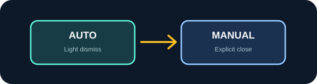

<div align="center">


[](LICENSE)

[](https://github.com/CyberLoop-dev/html-popover-api-lab/stargazers)




</div>

## 🧭 Overview
A small browser lab for the native HTML Popover API. Compare automatic popovers with light-dismiss behavior and manual popovers controlled through JavaScript methods.

## ✨ Features
- 🪟 Toggle an automatic popover with declarative HTML.
- 🎛️ Open and close a manual popover with `showPopover()` and `hidePopover()`.
- 🧾 Observe `beforetoggle` and `toggle` events.
- 🧭 Detect whether the browser supports the API.

## 🖥️ Demo
Run the app locally; no hosted demo is configured.

## 🚀 Quick Start
```bash
npm start
```
Open `http://127.0.0.1:4174` in a browser with Popover API support.

## 🧰 Tech Stack
- Node.js built-in HTTP server
- Native HTML Popover API
- Vanilla JavaScript, HTML, and CSS

## 🗂️ Folder Structure
```text
.
├── assets/mark.svg
├── public/app.js
├── public/index.html
├── public/styles.css
├── package.json
├── server.js
└── README.md
```

## 🗺️ Roadmap
- [ ] Add nested popover examples.
- [ ] Compare popover invoker relationships.
- [ ] Add a focus-management checklist.

## 🤝 Contributing
Test changes in browsers with and without Popover API support and describe the observed event sequence.

## 📄 License
MIT. See [LICENSE](LICENSE).

<div align="center">


</div>
